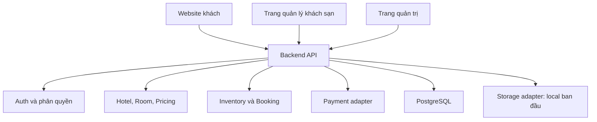

# Thiết kế hệ thống VietSage Booking

**Phiên bản:** 0.1 — bản thiết kế ban đầu  
**Phạm vi:** Website đặt phòng khách sạn và trang quản lý vận hành khách sạn  
**Trạng thái:** Bản nháp để thống nhất phạm vi trước khi triển khai

> Tài liệu này mô tả thiết kế mục tiêu. Chưa đối chiếu trực tiếp với mã nguồn của repository, vì vậy tên module, công nghệ và đường dẫn trong code cần được đồng bộ sau khi kiểm tra cấu trúc repo.

## 1. Mục tiêu

Xây dựng hệ thống cho phép khách tìm và đặt phòng trực tuyến; đồng thời cung cấp công cụ để khách sạn quản lý phòng, giá, tồn phòng và đơn đặt. Thiết kế cần ngăn đặt trùng, lưu đúng giá tại thời điểm đặt và cho phép thay đổi hạ tầng lưu ảnh về sau mà không phải sửa nghiệp vụ booking.

## 2. Phạm vi theo giai đoạn

### Giai đoạn đầu

- Khách xem/tìm khách sạn, loại phòng, giá và tình trạng phòng theo ngày.
- Khách tạo booking, thanh toán nếu cổng thanh toán được cấu hình, xem lịch sử và yêu cầu hủy.
- Nhân viên/chủ khách sạn quản lý khách sạn, loại phòng, số lượng phòng, giá, booking và nhận/trả phòng.
- Quản trị nền tảng quản lý tài khoản, khách sạn và trạng thái hoạt động.
- Ảnh được lưu tạm trên máy chủ/máy chạy ứng dụng thông qua một lớp lưu trữ trừu tượng.

### Chưa triển khai ban đầu

- Email và thông báo (email, SMS, push, thông báo trong ứng dụng).
- Tích hợp OTA/channel manager như Booking.com, Agoda hoặc các kênh khác.
- Đồng bộ nhiều khách sạn/chuỗi, chương trình khách hàng thân thiết và báo cáo nâng cao.

Các phần chưa triển khai không được mô phỏng bằng thao tác gửi giả. Có thể bổ sung sau qua adapter/module riêng mà không đưa phụ thuộc của nhà cung cấp vào nghiệp vụ booking.

## 3. Vai trò

| Vai trò | Quyền chính |
|---|---|
| Khách vãng lai | Tìm khách sạn, xem phòng và giá, bắt đầu đặt phòng |
| Khách hàng | Quản lý hồ sơ, xem booking của mình, thanh toán và yêu cầu hủy |
| Nhân viên khách sạn | Xem booking trong phạm vi khách sạn được cấp quyền; nhận/trả phòng |
| Chủ/quản lý khách sạn | Quản lý khách sạn, loại phòng, giá, tồn phòng, nhân viên và báo cáo |
| Quản trị nền tảng | Quản lý khách sạn, người dùng và cấu hình toàn hệ thống |

Mọi API quản lý phải kiểm tra quyền và phạm vi khách sạn ở backend. Không dựa vào `hotelId` do giao diện gửi lên làm bằng chứng phân quyền.

## 4. Kiến trúc đề xuất

Giai đoạn đầu dùng **modular monolith**: một backend triển khai thống nhất nhưng chia module nghiệp vụ rõ ràng. Cách này giữ giao dịch đặt phòng đơn giản và cho phép tách dịch vụ sau khi có nhu cầu thực tế.



### Module backend

- `identity`: tài khoản, đăng nhập, vai trò, quyền và phạm vi khách sạn.
- `hotel`: hồ sơ, địa chỉ, tiện ích và trạng thái khách sạn.
- `room`: loại phòng, sức chứa, phòng vật lý và trạng thái vận hành.
- `pricing`: giá theo ngày, phụ thu, chính sách giá.
- `inventory`: số lượng phòng có thể bán theo loại phòng/ngày.
- `booking`: giữ phòng, tạo đơn, xác nhận, hủy, nhận/trả phòng.
- `payment`: khởi tạo giao dịch, webhook/IPN, hoàn tiền và đối soát.
- `media`: nhận ảnh, kiểm tra tệp và gọi storage adapter.
- `audit`: ghi nhận các thay đổi quan trọng.

## 5. Dữ liệu nghiệp vụ

| Bảng | Nội dung chính |
|---|---|
| `users` | Tài khoản, thông tin xác thực, trạng thái |
| `roles`, `user_roles` | Vai trò và ánh xạ người dùng-vai trò |
| `hotels` | Khách sạn, địa chỉ, múi giờ, trạng thái |
| `hotel_members` | Người dùng được cấp quyền trong từng khách sạn |
| `room_types` | Loại phòng, sức chứa, mô tả, số khách tối đa |
| `rooms` | Phòng vật lý, mã phòng và trạng thái vận hành |
| `room_inventory` | Tồn bán được theo `room_type_id` và ngày |
| `room_rates` | Giá theo loại phòng/ngày và điều kiện giá |
| `bookings` | Mã đặt phòng, khách, ngày ở, tổng tiền và trạng thái |
| `booking_items` | Loại phòng, số lượng, giá từng đêm được chốt lúc đặt |
| `payments` | Nhà cung cấp, mã giao dịch, số tiền và trạng thái |
| `media_assets` | Storage key, loại nội dung, kích thước, chủ sở hữu |
| `audit_logs` | Người thực hiện, hành động, đối tượng và thời điểm |

### Quy ước dữ liệu

- Lưu thời điểm hệ thống dưới dạng UTC; lưu múi giờ của khách sạn để hiển thị và xác định ngày lưu trú.
- Ngày nhận phòng là ngày bắt đầu bao gồm; ngày trả phòng không bao gồm. Số đêm bằng `check_out - check_in`.
- Tiền lưu dưới dạng số nguyên theo đơn vị nhỏ nhất của tiền tệ hoặc kiểu decimal chính xác; không dùng số thực dấu phẩy động.
- Booking phải lưu ảnh chụp giá, tiền tệ, thuế/phụ phí và chính sách hủy tại thời điểm đặt. Không tính lại đơn cũ từ bảng giá hiện tại.
- Dùng trạng thái phòng vật lý (`available`, `occupied`, `maintenance`, ...) cho vận hành; dùng tồn kho theo ngày cho khả năng bán. Hai khái niệm này không thay thế nhau.

## 6. Booking và ngăn đặt trùng

Tồn phòng được quản lý theo **loại phòng và từng ngày lưu trú**, không khóa cứng một phòng vật lý ngay khi khách mới tìm kiếm. Phòng vật lý có thể được gán lúc nhân viên phân phòng hoặc check-in.

Khi giữ phòng, backend mở transaction và khóa/cập nhật nguyên tử các dòng tồn kho cho toàn bộ khoảng ngày `[check_in, check_out)`. Chỉ tạo hold nếu mọi ngày đều còn đủ số lượng. Nếu thiếu tồn kho ở bất kỳ ngày nào, rollback toàn bộ giao dịch.

`room_inventory` tối thiểu gồm:

- `hotel_id`, `room_type_id`, `stay_date`
- `total_count`, `blocked_count`, `reserved_count`
- unique constraint trên (`room_type_id`, `stay_date`)

Số phòng có thể bán = `total_count - blocked_count - reserved_count`. Quy tắc phải được thực thi trong database transaction, không chỉ bằng bước kiểm tra trước ở frontend.

### Trạng thái booking

`pending_payment` → `confirmed` → `checked_in` → `checked_out`

Nhánh kết thúc/ngoại lệ gồm `cancelled`, `expired`, `no_show`.

### Trạng thái payment

`unpaid`, `pending`, `paid`, `failed`, `refund_pending`, `refunded`, `partially_refunded`.

Booking và payment là hai vòng đời riêng. Ví dụ booking đã `cancelled` nhưng payment có thể còn `refund_pending`.

## 7. Luồng đặt phòng

1. Khách nhập địa điểm, ngày nhận/trả phòng, số khách và số phòng.
2. Backend trả danh sách loại phòng còn chỗ cùng tổng giá ước tính.
3. Khách gửi yêu cầu tạo booking. Backend kiểm tra giá, chính sách, điều kiện ngày và tồn kho lại trong transaction.
4. Backend tạo booking `pending_payment`, tạo hold tồn kho có hạn sử dụng và trả mã booking.
5. Nếu có thanh toán trực tuyến, backend khởi tạo giao dịch qua payment adapter. Nếu MVP chưa tích hợp cổng thanh toán, booking phải hiển thị rõ là chờ xác nhận/thanh toán theo quy trình được cấu hình.
6. Webhook/IPN được xác minh chữ ký, số tiền, mã đơn và trạng thái; xử lý idempotent để callback lặp không ghi nhận thanh toán hai lần.
7. Thanh toán hợp lệ thì chuyển booking sang `confirmed`; hold trở thành tồn đã đặt.
8. Hold quá hạn hoặc giao dịch thất bại thì giải phóng tồn kho đúng một lần và chuyển booking sang `expired` hoặc trạng thái phù hợp.

Không tin trạng thái thanh toán do trình duyệt gửi về trang kết quả. Backend chỉ xác nhận dựa trên thông điệp đã xác minh từ cổng thanh toán hoặc quy trình đối soát được kiểm soát.

## 8. Lưu ảnh: local trước, cloud sau

### Nguyên tắc thiết kế

Nghiệp vụ không đọc/ghi trực tiếp vào đường dẫn filesystem. Module `media` gọi một interface, ví dụ:

```text
StorageProvider
  put(file, metadata) -> storageKey
  getUrl(storageKey) -> URL hoặc đường dẫn truy cập
  delete(storageKey)
```

Giai đoạn đầu triển khai `LocalStorageProvider`; sau này thêm `S3StorageProvider`, Azure Blob hoặc nhà cung cấp phù hợp bằng cấu hình. Module khách sạn chỉ lưu tham chiếu `media_assets.id` hoặc `storage_key`, không lưu đường dẫn tuyệt đối kiểu `/home/app/...` vào bảng `hotels`.

### Quy tắc lưu local

- Lưu file trong thư mục dữ liệu được cấu hình, tách khỏi thư mục mã nguồn và thư mục public tĩnh.
- Tên file do server sinh ngẫu nhiên; không dùng trực tiếp tên file người dùng làm đường dẫn.
- Kiểm tra loại nội dung, kích thước, phần mở rộng và giới hạn số ảnh.
- API trả URL qua backend hoặc URL public tương đối; frontend không tự ghép đường dẫn filesystem.
- Sao lưu thư mục ảnh cùng database trong môi trường cần giữ dữ liệu.
- Local storage thích hợp cho phát triển/MVP trên một máy có ổ đĩa bền vững. Khi chạy nhiều instance hoặc nền tảng có filesystem tạm thời, cần chuyển sang shared/object storage trước khi mở rộng triển khai.

### Chuyển sang cloud sau này

1. Giữ nguyên `storage_key` logic và `media_assets`; thêm provider cloud.
2. Dùng công cụ migration copy file local lên cloud, giữ nguyên định danh media.
3. Kiểm tra số lượng, kích thước và checksum trước khi đổi provider mặc định.
4. Có giai đoạn đọc cloud trước, local fallback để đối chiếu; sau khi xác minh mới dừng ghi local.
5. Cập nhật cấu hình provider và dọn file local sau khi có bản sao lưu, thời gian ổn định và xác nhận không còn tham chiếu.

Không để bảng nghiệp vụ phụ thuộc vào tên nhà cung cấp cụ thể; cấu hình như `MEDIA_PROVIDER=local` hoặc `MEDIA_PROVIDER=s3` chỉ được đọc ở tầng cấu hình/khởi tạo.

## 9. Email và thông báo

Email và thông báo **không thuộc phạm vi triển khai ban đầu**. Không cần tạo hàng đợi hoặc tích hợp dịch vụ gửi trong MVP.

Khi bổ sung về sau, các sự kiện như `BookingConfirmed`, `BookingCancelled`, `PaymentSucceeded` có thể được chuyển đến module thông báo. Module này chịu trách nhiệm mẫu nội dung, retry, log kết quả và lựa chọn kênh gửi. Các nghiệp vụ booking không gọi trực tiếp Gmail/SMTP/SMS provider.

## 10. API chính

| Method | Endpoint | Mục đích |
|---|---|---|
| `GET` | `/api/hotels` | Tìm kiếm và lọc khách sạn |
| `GET` | `/api/hotels/{hotelId}` | Chi tiết khách sạn |
| `GET` | `/api/hotels/{hotelId}/availability` | Kiểm tra loại phòng, giá và tồn theo ngày |
| `POST` | `/api/bookings/holds` | Tạo booking/hold tạm thời |
| `GET` | `/api/bookings/{bookingCode}` | Tra cứu booking theo quyền |
| `POST` | `/api/bookings/{bookingCode}/cancel` | Yêu cầu hủy và tính chính sách áp dụng |
| `GET` | `/api/me/bookings` | Lịch sử booking của khách |
| `POST` | `/api/payments/{provider}/webhook` | Nhận callback thanh toán đã xác minh |
| `GET/POST/PATCH` | `/api/owner/room-types` | Quản lý loại phòng |
| `GET/PUT` | `/api/owner/inventory` | Quản lý tồn kho và lịch đóng phòng |
| `GET/PATCH` | `/api/owner/bookings` | Quản lý booking trong phạm vi khách sạn |
| `POST/DELETE` | `/api/owner/media` | Tải/xóa ảnh qua media module |

Các thao tác tạo booking và payment nên hỗ trợ idempotency key để retry do mạng không tạo đơn hoặc giao dịch trùng.

## 11. Yêu cầu bảo mật và độ tin cậy

- Hash mật khẩu bằng thuật toán phù hợp; không lưu mật khẩu dạng rõ.
- Dùng kiểm tra quyền phía backend cho từng module và từng `hotel_id`.
- Validate ngày, số khách, số phòng, giá, mã giảm giá và nội dung upload ở server.
- Giới hạn tần suất endpoint đăng nhập, tìm kiếm nhạy cảm, upload và tạo booking.
- Không ghi token, mật khẩu hoặc dữ liệu thẻ thanh toán vào log.
- Lưu lịch sử thay đổi giá, tồn kho, booking và hoàn tiền.
- Có backup database; kiểm tra khả năng khôi phục định kỳ.
- Webhook thanh toán cần xác minh chữ ký, chống phát lại và xử lý idempotent.

## 12. Lộ trình triển khai

1. Đồng bộ thiết kế với stack và cấu trúc repository hiện tại.
2. Hoàn thiện identity, role và phạm vi khách sạn.
3. Làm CRUD khách sạn, loại phòng, giá, tồn kho và media local adapter.
4. Làm tìm kiếm/availability và kiểm soát cạnh tranh tồn phòng.
5. Làm booking hold, hết hạn, hủy và lịch sử trạng thái.
6. Tích hợp cổng thanh toán nếu yêu cầu nghiệp vụ đã rõ; nếu chưa, giữ quy trình thanh toán thủ công được xác định rõ.
7. Hoàn thiện dashboard vận hành và báo cáo cơ bản.
8. Bổ sung cloud media, email/thông báo và OTA/channel manager theo ưu tiên thực tế.

## 13. Các quyết định cần xác nhận trước khi chốt thiết kế

- Nền tảng phục vụ một khách sạn, một chuỗi hay nhiều khách sạn độc lập?
- Khách có được đặt phòng không cần đăng nhập không?
- Thanh toán toàn bộ, đặt cọc hay trả tại khách sạn?
- Tồn phòng được quản lý theo loại phòng hay chọn phòng vật lý ngay khi booking?
- Giá, thuế, phí dịch vụ và chính sách hủy cần hỗ trợ mức độ nào trong MVP?
- Có cần đồng bộ OTA/channel manager trong giai đoạn kế tiếp không?
